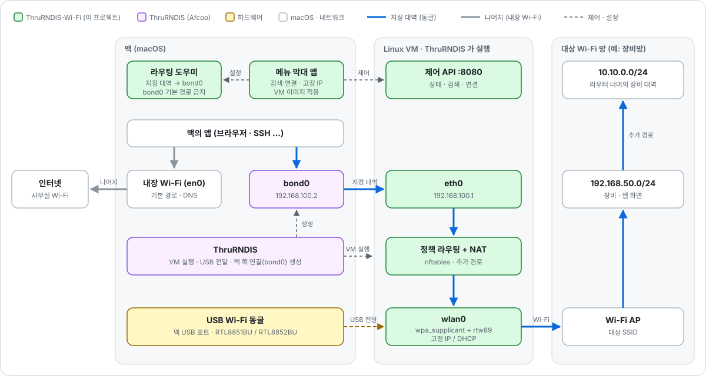

# ThruRNDIS-Wi-Fi

맥에 USB Wi-Fi 동글을 **두 번째 무선랜**으로 붙여 쓰게 해 주는 [ThruRNDIS](https://github.com/Afcoo/ThruRNDIS) 비공식 확장입니다.

맥 내장 Wi-Fi 는 인터넷에 그대로 두고, USB 동글로는 다른 Wi-Fi(인터넷이 없는 장비망·사내망 등)에 동시에 붙습니다. 지정한 대역만 동글로 보내므로 맥의 인터넷과 DNS 는 바뀌지 않습니다.

> [!NOTE]
> Afcoo/ThruRNDIS 와 관계없는 비공식 프로젝트입니다. ThruRNDIS 앱은 수정하지 않고, ThruRNDIS 가 지원하는 "수동 VM 자산" 설정으로 이 프로젝트의 VM 이미지를 쓰게 할 뿐입니다.

## 이런 때 씁니다

- 사무실 인터넷 Wi-Fi 에 붙은 채로 인터넷이 없는 장비·로봇·공장 Wi-Fi 의 웹 화면에 접속할 때
- Wi-Fi 를 바꿀 때마다 네트워크 위치, 고정 IP, 수동 경로를 바꿔 주던 일을 없애고 싶을 때

## 동작 방식



- ThruRNDIS 는 휴대폰 USB 테더링(RNDIS)을 맥에서 쓰게 해 주는 앱으로, 작은 Linux VM 에 USB 장치를 넘겨 처리합니다.
- ThruRNDIS-Wi-Fi 는 그 VM 이미지를 Wi-Fi 드라이버가 든 이미지로 바꾸고, 메뉴 막대에서 VM 의 Wi-Fi 를 조작합니다.
- 작은 라우팅 도우미(root 데몬)가 지정한 대역만 동글로 보냅니다. ThruRNDIS 연결이 맥의 기본 경로를 가져가지 못하게도 막습니다.

## 요구 사항

- Apple Silicon 맥, **macOS 27 이상** (ThruRNDIS 요구 사항)
- [ThruRNDIS](https://github.com/Afcoo/ThruRNDIS) (0.4.1 에서 확인): `brew install --cask afcoo/tap/thrurndis`
- 리눅스 커널 드라이버가 있는 USB Wi-Fi 동글. 아래 [지원 동글](#지원-동글) 의 칩이 기본으로 들어 있습니다.
- 관리자 암호 (라우팅 도우미를 설치할 때 한 번)

## 설치

1. [Releases](../../releases) 에서 `ThruRNDIS-Wi-Fi.zip` 을 받아 압축을 풀고, `ThruRNDIS-Wi-Fi.app` 을 **응용 프로그램** 폴더로 옮깁니다.
2. 처음 열 때 "확인되지 않은 개발자" 경고가 뜨면 **시스템 설정 → 개인정보 보호 및 보안** 아래쪽의 **그래도 열기**를 누릅니다. 공증받지 않은 앱이라 처음 한 번 필요합니다.
3. 메뉴 막대에 Wi-Fi 아이콘이 생깁니다.

## 처음 설정

ThruRNDIS 를 한 번 실행해 온보딩(Privileged Helper 승인)을 마친 뒤 진행합니다.

1. **ThruRNDIS 에 적용**: 메뉴에서 누르면 ThruRNDIS 가 재시작되며 ThruRNDIS-Wi-Fi 의 VM 이미지로 부팅합니다. 원래 ThruRNDIS 설정은 백업됩니다.
2. **동글 넘기기**: 동글을 꽂고, 메뉴 막대의 **가상 머신 액세서리**에서 동글을 **ThruRNDIS** 로 넘깁니다. ThruRNDIS 의 USB 연결 확인 창이 뜨면 승인합니다.
3. **라우팅 도우미 설치**: 메뉴 아래쪽 **설치 (관리자 암호)**.
4. **연결**: **검색** → 네트워크 선택 → 비밀번호 입력.

연결되면 메뉴 위쪽에 주소와 함께 **맥 연결 준비됨**이 표시됩니다.

## 사용법

### 네트워크

- 목록에서 고르고 비밀번호를 넣어 연결합니다. 숨김 네트워크는 **다른 네트워크(숨김)…** 에서 SSID 를 직접 넣습니다.
- WPA2, WPA3(SAE), 개방망을 지원합니다.
- 연결한 네트워크는 저장됩니다(비밀번호는 키체인). 앱과 VM 을 다시 켜면 가장 최근 네트워크에 자동으로 붙습니다.
- **저장된 네트워크** 에서 연결, 비밀번호 변경, IP 설정, 삭제를 합니다.
- 비밀번호가 틀리면 메뉴에 바로 표시되고, 그 자리에서 다시 입력할 수 있습니다.

### 고정 IP 와 추가 경로

DHCP 서버가 없는 망은 저장된 네트워크의 **IP** 버튼에서 주소를 지정합니다. 처음 연결할 때 비밀번호 칸 아래 **고정 IP 직접 입력…** 에서 넣어도 됩니다.

| 칸 | 예 | 설명 |
|---|---|---|
| IP 주소 | `192.168.50.20` | 비우면 DHCP |
| 서브넷 마스크 | `255.255.255.0` | `/24`, `24` 도 됩니다. 비우면 /24 |
| 게이트웨이 (선택) | `192.168.50.1` | 없으면 같은 대역끼리만 통신 |
| DNS (선택) | `1.1.1.1, 8.8.8.8` | 3개까지 |
| 추가 경로 (선택) | `10.10.0.0/24` → `192.168.50.254` | 그 망 안의 다른 라우터 너머에 있는 대역. **+** 로 줄을 추가해 왼쪽에 대역, 오른쪽에 그 대역으로 가는 게이트웨이를 넣고, **−** 로 지웁니다. 8줄까지 |

같은 IP 를 이미 쓰는 장치가 있으면(ARP 로 확인) 주소를 붙이지 않고 경고합니다. 맥 내장 Wi-Fi 가 같은 망에 같은 IP 로 붙어 있을 때 흔히 생깁니다.

### 맥 라우팅

| 모드 | 동작 |
|---|---|
| **지정 대역만** (기본) | 동글 망의 대역, 그 네트워크의 추가 경로, 아래 **추가 대역** 만 동글로 보냅니다. 나머지와 DNS 는 맥 기본 경로를 씁니다. |
| **전체 트래픽** | 모든 IPv4 를 동글로 보냅니다. DNS 설정은 맥 그대로입니다. |
| **끔** | 동글로 보내는 경로를 만들지 않습니다. |

- 동글 망 연결이 끊긴 동안에는 경로를 거둬들이고 맥 기본 경로를 씁니다. 다시 붙으면 자동으로 돌아옵니다.
- 맥에 같은 대역의 경로가 이미 있으면 덮어쓰지 않고 메뉴에 충돌로 표시합니다.

### 예: 인터넷 없는 장비망에 접속하기

장비망 Wi-Fi 는 DHCP 가 없고 `192.168.50.0/24` 이며, 장비는 그 망의 라우터 `192.168.50.254` 너머 `10.10.0.0/24` 에 있다고 합시다.

1. 장비망 Wi-Fi 에 연결합니다. 주소를 못 받으면 메뉴에 안내가 뜹니다.
2. **저장된 네트워크 → IP**: IP `192.168.50.20`, 서브넷 `255.255.255.0` 을 넣고, 추가 경로의 **+** 를 눌러 왼쪽에 `10.10.0.0/24`, 오른쪽에 `192.168.50.254` 를 넣은 뒤 **저장**합니다.
3. 맥 라우팅은 **지정 대역만**으로 둡니다.

이제 브라우저에서 `http://10.10.0.5:8080` 같은 장비 주소가 열리고, 인터넷은 내장 Wi-Fi 로 계속 됩니다.

## 지원 동글

VM 이미지에 기본으로 들어 있는 드라이버입니다(리눅스 커널 드라이버, [`vm/drivers.conf`](vm/drivers.conf)). 실제 동글로 확인한 것은 RTL8851BU 계열 `0bda:b831` 하나이고, 나머지는 드라이버만 들어 있습니다.

| 제조사 | 칩 | 드라이버 |
|---|---|---|
| Realtek | RTL8851BU, RTL8852BU (Wi-Fi 6) | `rtw89` (`0bda:b831` 확인) |
| Realtek | RTL8821CU, RTL8822BU, RTL8822CU, RTL8812AU, RTL8821AU, RTL8814AU, RTL8723DU | `rtw88` |
| Realtek | RTL8188EU/CU/FU/RU, RTL8192CU/EU, RTL8723AU/BU, RTL8710BU | `rtl8xxxu` |
| MediaTek | MT7921AU (Wi-Fi 6), MT7612U, MT7610U, MT7601U | `mt76`, `mt7601u` |
| Ralink | RT2870, RT3070, RT3572, RT5370, RT5572 | `rt2800usb` |
| Qualcomm Atheros | AR9271, AR7010 | `ath9k_htc` |

지원하지 않는 동글을 넘기면 메뉴에 **"USB 장치 xxxx:yyyy 를 맡을 드라이버가 VM 에 없습니다"** 가 뜹니다.

### 다른 동글 쓰기 (드라이버 추가)

VM 의 리눅스 커널(Alpine linux-stable)에는 위 표 말고도 USB Wi-Fi 드라이버가 더 있습니다. 대부분 표에 한 줄을 넣고 다시 빌드하면 됩니다. 빌드에는 Docker Desktop 이 필요합니다([직접 빌드](#직접-빌드)).

1. 동글의 USB ID(`xxxx:yyyy`)를 확인합니다. 메뉴의 안내 문구나 **시스템 정보 → USB** 에 나옵니다.
2. 어떤 드라이버가 맡는지 찾습니다.

   ```sh
   ./vm/tools/find-driver.sh 0bda:b812
   ```

3. [`vm/drivers.conf`](vm/drivers.conf) 에 한 줄 넣습니다. 펌웨어는 드라이버가 밝힌 파일을 빌드가 알아서 넣으므로, 보통은 모듈 이름과 펌웨어 패키지만 적으면 됩니다.

   ```text
   rtw88_8822bu  pkg=linux-firmware-rtw88
   ```

   커널이 아직 모르는 USB ID 지만 같은 칩이 지원된다면, 그 칩의 기존 ID 를 `newid=` 로 이어 줍니다(예: `newid=0bda:b831/0bda:b851`).
4. `./app/build_app.sh --install` 로 다시 빌드·설치하고, 메뉴의 **VM 이미지 업데이트** 를 누릅니다.

커널에 아예 없는 외부 드라이버(제조사가 배포하는 소스 등)는 지금은 지원하지 않습니다.

## 되돌리기와 제거

- **원래 이미지로** (메뉴 아래쪽): ThruRNDIS 의 VM 설정을 적용 전으로 되돌립니다.
- 라우팅 도우미 **제거** (관리자 암호): 데몬과, 데몬이 넣은 경로를 지웁니다.
- 앱을 지우려면 위 두 가지를 한 뒤 앱을 휴지통에 넣습니다. 남는 데이터는 `~/Library/Application Support/ThruRNDIS-Wi-Fi` 와 키체인의 `ThruRNDIS-Wi-Fi: <SSID>` 항목입니다.

## 문제 해결

- **VM 이 아직 실행되지 않았습니다**: ThruRNDIS 가 켜져 있는지, 동글을 ThruRNDIS 로 넘겼는지 확인합니다.
- **연결됐는데 "맥 연결 준비 중"**: 주소를 받는 중입니다. DHCP 가 없는 망이면 고정 IP 를 지정합니다.
- **메뉴의 192.168.100.2 연결이 생기지 않음**: ThruRNDIS 메뉴에서 네트워크 라우팅을 시작하거나 ThruRNDIS 를 다시 실행합니다.
- **느리거나 자주 끊김**: 동글 신호가 -70 dBm 보다 약하면 불안정해질 수 있습니다. 동글을 USB 연장선으로 맥에서 떨어뜨리거나 AP 쪽으로 옮겨 봅니다.
- **국가 코드**: 기본은 `KR` 입니다. 바꾸려면 `defaults write io.github.afy0817.ThruRNDIS-Wi-Fi Country US` 를 실행하고, 앱을 다시 실행한 뒤 **원래 이미지로** → **ThruRNDIS 에 적용** 을 차례로 누릅니다.
- **진단 정보**: VM 의 커널 로그, Wi-Fi 상태, 경로를 텍스트로 볼 수 있습니다. VM 주소(`192.168.64.x`)는 ThruRNDIS 로그의 `Guest VZNAT network discovered` 줄에 있습니다.

  ```sh
  curl "http://192.168.64.2:8080/cgi-bin/api?action=diag&token=$(defaults read io.github.afy0817.ThruRNDIS-Wi-Fi GuestToken)"
  ```

## 직접 빌드

필요한 것: Xcode Command Line Tools(Swift 5.10 이상), Docker Desktop(VM 이미지를 Alpine arm64 컨테이너에서 만듭니다).

```sh
./vm/build.sh                  # dist/vm_assets: 커널 + initramfs
./app/build_app.sh             # dist/ThruRNDIS-Wi-Fi.app (VM 이미지가 없으면 먼저 만듦)
./app/build_app.sh --install   # /Applications 에 설치
```

릴리스용 압축 파일:

```sh
ditto -c -k --keepParent dist/ThruRNDIS-Wi-Fi.app dist/ThruRNDIS-Wi-Fi.zip
```

### 구조

```text
app/              메뉴 막대 앱 (SwiftUI)
helper/           라우팅 도우미: launchd 데몬과, ThruRNDIS 연결이 기본 경로가 되지 않게 하는 도구
vm/               VM 이미지 빌드: Alpine linux-stable, Wi-Fi 드라이버·펌웨어, wpa_supplicant, 제어 API
vm/drivers.conf   VM 에 넣을 USB Wi-Fi 드라이버 목록
vm/tools/         find-driver.sh: USB ID 로 드라이버 찾기
```

## 라이선스

- `app/`, `helper/`: MIT
- `vm/`: GPL-2.0-or-later (ThruRNDIS VM 자산 스크립트를 바탕으로 함)

파일마다 SPDX 헤더가 있고, 라이선스 원문은 [`LICENSES/`](LICENSES) 에 있습니다.

## 감사

- [ThruRNDIS](https://github.com/Afcoo/ThruRNDIS) (Afcoo): VM 실행, USB 전달, 맥 쪽 네트워크 연결을 모두 ThruRNDIS 가 맡습니다.
- Linux `rtw89` 드라이버, Alpine Linux, wpa_supplicant.
